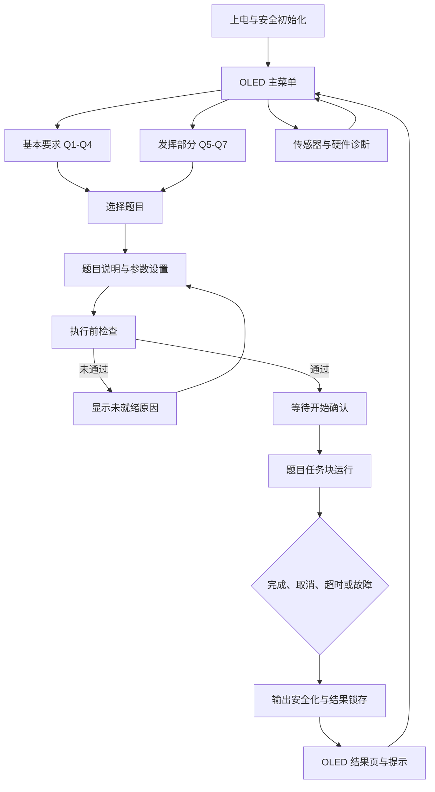
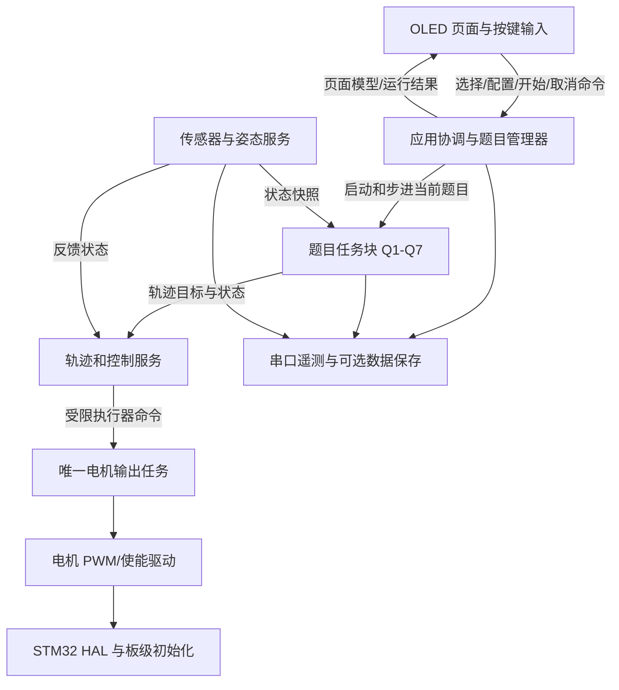

# 风力摆项目逻辑框架

本文是固件后续设计和实现的约定。新增功能应遵循“**选择题目 → 配置参数 → 检查条件 → 执行任务块 → 显示结果 → 安全退出**”的流程。比赛题目是产品主线；传感器、校准和显示设置是支撑主线的辅助功能。

2026-11-16 阶段安排：电机驱动开发和新增上板测试暂停；完整 OLED 菜单/UI 待题目任务实现后再统一安排题目选择、运行状态和结果汇总。最近烧录的默认固件仍为独立的 [电机1测试](电机1测试.md)，包含单路输出测试、串口日志与精简 OLED 状态页，不并行启动题目控制链路。本次需求整理只更新文档，不改变已烧录固件。台架测试按键和 PWM 由测试任务独占，切回题目模式后再交回对应任务，避免多个任务写同一执行器。

本轮测试按键统一为 KEY1=PC13、KEY2=PC0、KEY3=PC1。PWM 初始化为零后 EN 默认高，KEY1 长按启动、松键或 KEY2/3 清零 PWM 停止；硬故障仍关闭 EN。该台架模式与下文尚未解锁的题目模式分别管理输出。后续构建、烧录与上板读回统一复用 [编译烧录流程](编译烧录流程.md) 及 `Tools/build_flash.ps1`。

电机测试状态页由优先级 1 的独立任务按 100 ms 目标周期刷新，显示 KEY1、PWM 占空比/CCR、EN 与停止原因；通过独立单槽队列读取快照，不处理按键和执行器命令。电机任务优先级 5、周期 10 ms，可以抢占显示；显示失败最多每秒重试，错过显示周期时丢帧。现有 I²C 底层仍为阻塞式传输；接板后应检查步进间隔与实际 PWM 波形，不把降低刷新率等同于已验证实时性。

## 0. 需求依据与项目范围

需求以根目录 [风力摆控制系统(B题).pdf](../风力摆控制系统(B题).pdf) 和用户后续确认的调整为准。训练题文档已按要求删除，其中的附加验收项不再作为本项目的开发约束。后续按 B 题 Q1–Q7 组织任务，保留原题的参数设置、计时、声光提示及运动精度目标。

IMU 静止校准与零偏处理作为基础能力保留，具体约定见第 6.1 节。完整数据记录作为可选调试功能规划，先复用现有串口遥测，再按调参需要增加电脑端保存，具体见第 6.2 节。

## 1. 产品交互目标

上电后先进入安全初始化。OLED 主菜单以题目编号组织功能，用户选择一问后进入该问的参数页和运行页。任务完成、超时、故障或用户取消时，系统先把执行器带到安全状态，再显示结果并允许返回题目菜单。



OLED 的一级菜单建议为：

1. **基本要求**：Q1 自由摆直线、Q2 可调幅直线、Q3 指定方向直线、Q4 制动。
2. **发挥部分**：Q5 圆周轨迹、Q6 抗风扰、Q7 其他扩展。
3. **传感器与诊断**：姿态、加速度、陀螺仪、校准状态、外设状态。
4. **系统设置**：显示设置、版本和硬件信息。

进入 Q1–Q7 后先显示该问的目标和参数，再由用户明确确认开始。IMU 实时查看和显示设置不能替代题目入口，也不能绕过题目任务管理器直接操作电机。

## 2. 题目与任务块映射

每问对应一个独立的“题目任务块”（Problem Task Block）。题目块负责本问的参数、运行阶段、完成条件和结果；共享的传感、姿态融合和执行器服务由系统层提供。

| 菜单项 | 题目目标 | 题目块需要处理的参数和结果 |
|---|---|---|
| Q1 自由摆直线 | 从静止开始，15 秒内完成类似自由摆运动；直线长度不少于 50 cm，线性度偏差不超过 ±2.5 cm，并考察重复性 | 启动条件、运行计时、轨迹长度/偏差、完成提示和试次记录 |
| Q2 可调幅直线 | 从静止开始，15 秒内画出可设长度 30–60 cm 的直线；长度偏差不超过 ±2.5 cm，并考察重复性 | 目标长度、幅值轨迹、超时、实际长度/偏差和试次记录 |
| Q3 指定方向直线 | 可设摆动方向，从静止开始，15 秒内沿设定方向画出不少于 20 cm 的直线 | 方向角、最小长度、坐标零方向、完成角度/长度和超时 |
| Q4 制动 | 摆体拉起 30°–45° 后释放，5 秒内制动至静止 | 初始角度范围、静止判定阈值、制动时限、静止确认和结果 |
| Q5 圆周轨迹 | 以静止光点为圆心，半径 15–35 cm，30 秒内重复 3 圈；轨迹落在目标半径 ±2.5 cm 圆环内 | 目标半径、旋向、圈数、时间、径向偏差和完成提示 |
| Q6 抗风扰 | 延续 Q5 圆周运动，在 1–2 m 处施加 50–60 W、水平风扰 5 秒；停止后 5 秒内恢复合格圆周轨迹 | 风扰阶段、5 秒恢复计时、恢复判据、轨迹误差和结果 |
| Q7 其他 | 比赛发挥部分中的扩展项，待确定具体目标后增加 | 必须先写明目标、参数、前置条件、完成判据和安全边界，再注册题目块 |

各题按比赛要求提供清晰的 OLED 状态提示；蜂鸣器可作为声提示。激光是轨迹测量/指示的一部分，不能被当作通用的完成提示或随意闪烁。若以后采用指示灯，须先确认板上可用引脚及其硬件连接。

## 3. 统一生命周期与状态机

所有题目共享以下生命周期，不能在 UI 回调里直接运行长时间控制循环：

```text
IDLE
  -> SELECTED
  -> CONFIGURING
  -> PRECHECK
  -> READY_TO_START
  -> RUNNING
  -> COMPLETED | FAILED | TIMED_OUT | ABORTED
  -> SAFE_STOP
  -> RESULT
  -> IDLE
```

- `PRECHECK` 验证 IMU 在线、校准有效、传感器数据新鲜、必要参数在范围内、驱动器无故障、执行器输出门控允许；条件不全时显示具体原因并留在检查/配置页。
- `READY_TO_START` 等待用户确认，不因选中菜单项而自动启动风机。
- `RUNNING` 按题目定义的阶段状态机运行，周期性更新状态和结果指标；必须监视超时、传感器失效、驱动故障和取消请求。
- 任意故障或取消都进入 `SAFE_STOP`：撤销电机使能、PWM 清零、激光输出按安全策略关闭，并锁存故障/退出原因。
- `RESULT` 显示完成/失败原因、耗时、关键测量值及试次编号。用户确认返回后才清理题目上下文。

## 4. 软件分层与依赖方向

依赖从硬件适配层向上提供能力；上层通过服务接口使用下层，不能由题目块直接写 GPIO、定时器寄存器或 HAL 句柄。



目标代码职责如下（先按职责增量拆分；不为整理而搬动 CubeMX 生成的 `main.c`、启动文件和 HAL 文件）：

| 模块 | 职责 |
|---|---|
| `Core/Src/main.c`、`board_msp.c` | 时钟、GPIO、I2C、SPI、TIM、UART、ADC 等板级初始化；保持生成代码边界清楚 |
| `Core/Src/imu/` | ICM-45686 总线适配、设备初始化和原始/换算数据读取 |
| `Core/Src/kk_oled/`、`kk_ui/` | SSD1306 图形底层和通用 UI 库，不放题目控制逻辑 |
| 应用协调模块（后续建立） | 题目注册表、当前题目实例、生命周期状态机、按键命令与任务事件分发 |
| 传感与融合服务（后续拆分） | IMU 采样、静止校准、姿态融合、数据新鲜度和有效性 |
| 控制服务（后续建立） | 坐标系、轨迹生成、控制器、混控和限幅；输出统一的受限执行器命令 |
| 题目块（后续建立） | 每问独立参数、阶段状态机、进入/周期更新/退出、完成判据和结果 |
| OLED 题目页面（后续拆分） | 主菜单、参数页、运行页、诊断页和结果页；只发送应用命令并呈现模型 |
| 遥测与可选数据保存（后续增强） | 输出状态快照；按调参需要保存时间戳、题目参数、传感器、控制量及试次结果，不阻塞控制链路 |

新增模块建议按职责逐步加入 `Core/Inc/app/`、`Core/Inc/control/`、`Core/Inc/problems/` 和对应 `Core/Src/` 子目录；在 STM32CubeIDE 中确认新源文件进入 Debug/Release 构建后再依赖该目录。不要修改或移动第三方库、HAL、CMSIS 或 FreeRTOS 内核文件来承载业务逻辑。

建议逐步收敛到以下业务目录；这是目标结构，不表示所有文件已经创建：

```text
Core/
├─ Inc/
│  ├─ app/          # 题目 ID、参数/结果模型、题目注册表和管理器接口
│  ├─ control/      # 坐标变换、轨迹生成、控制器和混控接口
│  ├─ services/     # IMU、姿态/校准、故障监视和执行器安全门控接口
│  ├─ problems/     # 公共题目块接口及 Q1-Q7 参数接口
│  └─ ui/           # 菜单命令、页面模型和题目状态显示接口
└─ Src/
   ├─ app/          # 管理器任务、题目注册和统一生命周期
   ├─ control/      # 与具体题目解耦的控制和轨迹算法
   ├─ services/     # 传感器/姿态/校准/故障/输出门控实现
   ├─ problems/     # problem_q1.c ... problem_q7.c
   ├─ ui/           # OLED 主菜单、题目参数/运行/结果页面
   ├─ imu/          # 已存在的 ICM-45686 适配和驱动
   ├─ kk_oled/      # 已存在的 OLED 库
   └─ kk_ui/        # 已存在的通用 UI 库
```

迁移采用“新增职责文件 → 更新 CubeIDE 构建并验证 → 再迁移旧实现”的顺序。当前 `pendulum_app.c` 同时包含采样、融合、占位轨迹、MotorTask 和遥测；后续拆分时按任务所有权迁移，不做一次性的大重命名，以便每一步都可编译、可回退。

## 5. 题目块接口约定

题目块应是可暂停/取消的非阻塞状态机，不是一个永久占用 CPU 的大循环。建议每个题目至少具备这些逻辑入口：

```c
typedef struct {
  bool (*validate)(const ProblemParams *params, ProblemError *error);
  void (*enter)(ProblemContext *context, const ProblemParams *params);
  void (*step)(ProblemContext *context, const ProblemInputs *inputs,
               ProblemOutputs *outputs);
  void (*cancel)(ProblemContext *context, ProblemOutputs *outputs);
  void (*get_result)(const ProblemContext *context, ProblemResult *result);
} ProblemTask;
```

以上是接口约定示意，尚未在当前固件中实现。每块必须：

- 只通过上下文接收传感数据、时间、用户取消/故障事件；不直接访问全局 UI 状态或 HAL 句柄。
- `step` 有界、快速、可重复调用；不 `HAL_Delay`、不等待按键、不做无超时阻塞，也不自行创建失控的 FreeRTOS 任务。
- 将目标轨迹/受限命令交给控制服务，由唯一的电机输出任务进行限幅、故障检查和最终写入。
- 在参数校验、进入、运行中和退出阶段都能报告状态；任何错误可转入统一安全停止路径。
- 用统一结果结构记录题目 ID、设置参数、起止时间、完成状态、关键误差、故障码和试次编号。

题目 ID 与显示名称集中注册，菜单不得复制一套私有的 ID 映射。添加新题时同时补齐注册项、参数范围、生命周期处理、OLED 页面状态、结果指标、错误路径和验证记录。

## 6. FreeRTOS 数据流和任务边界

现有数据链路为 `ImuTask → FusionTask → TrajectoryTask → MotorTask → TelemetryTask`，显示任务从显示队列获取快照。后续保持数据单向流动，以队列传递有时间戳的数据和命令；队列长度、覆盖策略和更新频率按数据语义选择。

- **IMU 采样**拥有传感器总线，发布原始样本和有效性/时间戳。
- **融合服务**消费样本，提供校准偏置和姿态快照；校准完成是启动闭环题目的必要条件。
- **题目管理器**响应 OLED 菜单命令，管理一个活动题目实例；不能同时运行多个会争用风机的题目。
- **题目管理器任务**拥有生命周期状态和当前题目上下文，串行处理开始/取消/故障等重要事件；按固定控制周期调用活动题目的有界 `step`。
- **题目块**根据参数和传感器快照推进本题阶段，产出轨迹/目标值与状态，不直接操作硬件。
- **控制服务**将目标轨迹与姿态反馈转换为受限的电机命令；控制算法可由控制周期任务调用，不要求每个服务都新建独立 FreeRTOS 任务。
- **MotorTask**是 PWM 和电机使能的唯一写入者；实施门控、限幅、故障优先和超时置零。
- **UI Task**以固定周期扫描按键、更新页面并发出“选择/开始/取消/返回”消息；不执行控制算法。
- **TelemetryTask**读取快照并输出调试/试次记录；串口阻塞不能拖慢采样与控制。

队列消息应携带时间戳、状态/错误码和有效标志。实时队列可覆盖旧的传感器快照以维持最新数据；开始、取消、故障和完成事件不得因覆盖而丢失，应使用事件队列或任务通知。共享结构只允许单一所有者写入，通过队列快照发布，避免 UI 与控制逻辑并发读写同一组可变字段。

### 6.1 保留：IMU 校准与零偏处理

现有题目控制链路在启动时，以 500 Hz 目标采样率累计 5000 个连续有效的静止样本，约需 10 秒。根据加速度模长和角速度检查静止状态；检测到运动时清空累计并重新等待。对三轴陀螺仪求均值作为零偏，姿态积分使用扣除零偏后的角速度。偏置保存在 RAM 中，重启后重新校准；当前电机1测试模式不启动这条 IMU 链路。

后续拆分传感服务时保留以上流程，并提供等待静止、校准进度、三轴偏置和有效状态。重新校准入口安排在待机状态，运行中保持本次有效偏置；校准未完成时不启动闭环题目。重校准命令和相关菜单属于后续开发，当前尚未实现。

摆体静止零位与陀螺仪零偏分别管理：零位用于定义目标姿态和坐标，零偏用于修正角速度。先核对安装轴向、正负号和静止零位，再接入各题控制。

### 6.2 可选：调试数据记录

数据记录用于查看校准效果、定位控制问题和比较不同参数。电脑端采集器按会话保存串口 CSV、原始字节、主机接收时间、字段说明和异常事件；采样、融合和电机任务保持优先，OLED 仅显示摘要，目标刷新周期为 100 ms。

| 层次 | 当前能力 | 后续按需增强 |
|---|---|---|
| 运行快照 | 当前电脑采集器已稳定保存电机1测试的 28 列串口快照，并保留原始字节、主机时间和校验事件 | 题目控制链路接入后增加 IMU 原始值、姿态、目标值、PID 分项、请求/实际 PWM、题目/试次编号、校准偏置和有效标志 |
| 试次信息 | 采集会话保存开始/结束时间、端口、协议、连接次数、有效/异常行数和本地最近烧录清单 | 题目菜单接入后增加题目参数、试次编号、退出原因和结果 |
| 保存方式 | `Tools/serial_capture.py` 将串口快照保存为 `telemetry.csv`，并保留 `raw.bin`、`events.csv`、`fields.csv`、`session.json` | 题目链路稳定后再决定是否增加 TF 卡或更高带宽记录 |

现有遥测采用快照覆盖，不能称为全采样率、无丢失的完整记录。电脑端保留每次收到的原始字节，并对字段数、枚举、范围和协议头校验；坏行只进入事件记录，不会被静默标成有效值。主机序号不是 MCU 序号，时间间隔异常只能标记为疑似间隙，不能据此精确计算丢帧数。`bus_current_adc` 当前仍为 ADC 原始读数。调试记录的完善程度不作为新增题目验收门槛。

## 7. 题目判据与执行器边界

各题完成条件采用第 2 节列出的 B 题原始目标，包括直线长度和偏差、方向、制动时限、圆周半径/圈数及抗扰恢复时间。参数设置、开始/完成/超时状态与原题要求的提示沿用统一题目生命周期。

未解锁的题目控制链路继续保持：

- 电机使能 PD7 为低，TIM1 四路比较值为零；激光 PD8 为低。独立电机1测试固件沿用文首及测试文档中的 EN 默认高策略。
- 题目页可展示参数和未就绪原因，执行器启动统一由任务管理器检查条件。
- 任意传感器失联、过期、驱动器故障、任务超时、任务管理器异常或用户取消，输出进入同一个安全停止入口。
- PID、轨迹精度和风机混控的解除必须以台架/实物测试结果为依据，不由 OLED 菜单中的普通设置开关直接开启。

## 8. 当前实现状态与开发顺序

| 能力 | 当前代码状态 | 后续处理 |
|---|---|---|
| SSD1306 OLED、按键和 KK_UI 页面 | 已有底层适配和状态/传感器/校准/显示/关于页面 | 调整一级菜单，使 Q1–Q7 成为主线入口 |
| ICM-45686 SPI 驱动与采样 | 已接入 IMU 采样任务；曾通过 J-Link 检查到初始化和 5000 点校准完成状态 | 保留静止校准和零偏扣除，完善有效性/过期检查与待机重校准入口 |
| 姿态融合 | 已有陀螺仪积分与加速度互补融合实现 | 标定坐标、符号、零位、采样抖动和动态精度 |
| 题目管理器与 Q1–Q7 菜单执行 | 尚未实现 | 先建立统一生命周期、注册表和取消/故障事件路径 |
| PID/Q1 算法骨架 | 已加入离散 PID、双轴姿态 PID、四路混控和 Q1 余弦往返轨迹；Q1 可由应用 API 请求，轨迹任务计算目标、PID 分项和请求占空比 | 通过 OLED 题目管理器接入请求 API；实测摆长、坐标符号、风机方向和 PID 参数后再做台架验证 |
| 电机安全输出 | 当前 `MotorTask` 保持电机禁用、PWM 清零；`PendulumApp_SetMotorsArmed` 不会使能电机 | 保持单一输出所有权，并补齐故障锁存/限幅和台架解锁流程 |
| PWM 硬件映射 | 软件索引按电机板 PWM1..PWM4 对应 TIM1_CH1..CH4；主控网名 PWM4..PWM1 通过交叉焊接对齐 | 依据 [硬件引脚分配](硬件引脚分配.md) 焊接，通电前逐路核对；实测电机方向后再标定混控 |
| 调试数据记录 | 题目链路输出 CSV 快照；电脑端已可按会话保存并校验 COM9 数据 | 题目链路稳定后增加题目/试次信息和结果字段 |

建议开发顺序：

1. 当前先整理 B 题任务模型和共享传感服务，保留静止校准、零偏处理与姿态坐标检查；电机驱动开发维持暂停。
2. 建立题目 ID、参数、结果、事件模型和统一生命周期，将 Q1 的应用请求 API 接入题目管理器；完整 OLED 菜单最后统一接入。
3. 确定控制算法所需的摆长、坐标零位和风机编号/方向。
4. 恢复电机开发后完善唯一的执行器门控与台架诊断，验证单路输出、方向和限幅。
5. 逐项验证 Q1 轨迹到双轴 PID、四路混控的符号和比例，再实现 Q4 制动、Q2/Q3 直线任务、Q5 圆周和 Q6 抗扰；依据 B 题相应指标调整参数。
6. 使用电脑端采集器保存调参和校准会话；各题稳定后汇总 OLED 参数页、运行页、结果页，再考虑 Q7 扩展。

## 9. 后续改动检查表

任何新增题目或硬件功能都应回答：

1. 它对应哪一问/哪条验收指标，OLED 从哪里进入？
2. 参数有哪些单位、范围、默认值和保存策略？
3. 开始前要求哪些传感器、校准、驱动器和安全条件？
4. 运行状态机、完成判据、超时、故障、取消和安全退出分别是什么？
5. 由哪个服务拥有硬件写入权，数据通过哪条队列发布？
6. 怎样判断 B 题对应目标已完成，需要哪些运行结果和调试数据？
7. `.ioc`、引脚分配、Debug/Release 构建和实物测试记录是否同步更新？

缺少其中任一项时，先补充设计和诊断页面，不把未验证行为接入真实执行器。
