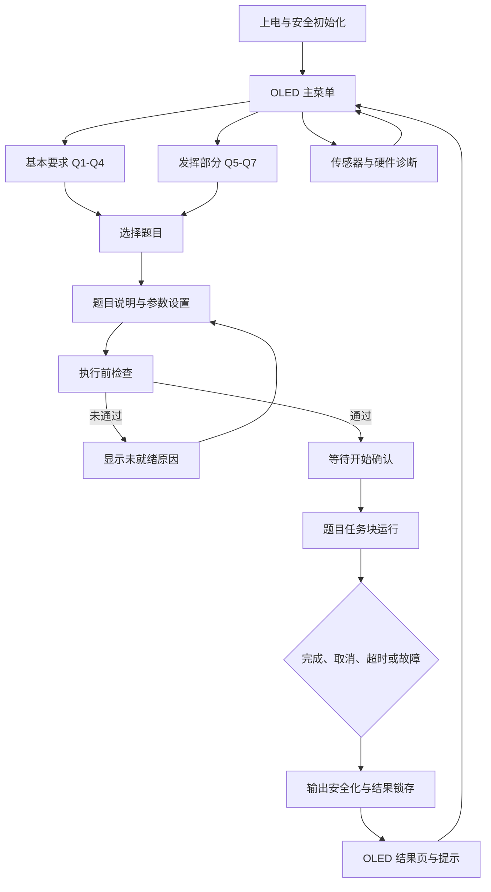
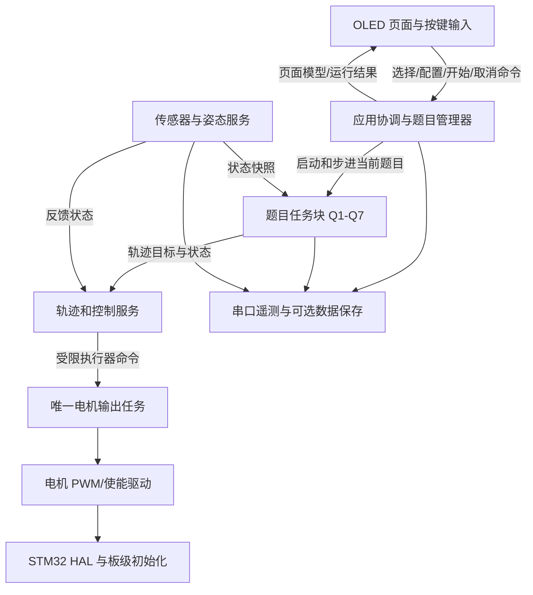

# 风力摆项目逻辑框架

本文是固件后续设计和实现的约定。新增功能应遵循“**选择题目 → 配置参数 → 检查条件 → 执行任务块 → 显示结果 → 安全退出**”的流程。比赛题目是产品主线；传感器、校准和显示设置是支撑主线的辅助功能。

2026-11-23 重新整理题目控制的设计基线见 [B 题题目控制重构方案](题目控制重构方案.md)。该文档记录了参考仓库 `2015-Electronical-Competition-Code---Renesas-Cup`（commit `06eb627ce8a29a26bd5301414d9521f60a0a4aba`）的借鉴边界、统一题目数据模型、轨迹/控制/混控职责和 Q1–Q6 验收逻辑。本文继续作为工程约定，后续实现以两份文档一致的部分为准；现有 Q1/Q2 代码仍属于原型，不能把窗口到时当作题目通过。

2026-11-16 的阶段安排和电机1台架流程仍保存在 [电机1测试](电机1测试.md) 与根目录交接记录中。2026-11-24 已接通 Q1 参考轨迹与速率 PID，并完成本地构建；默认 OLED 仍是 Q2 专用页，完整题目菜单/UI 待统一题目管理器接入。台架测试与题目模式必须由不同配置和唯一输出任务管理，不能让多个任务同时写执行器。

台架按键编号为 KEY1=PC0、KEY2=PC1、KEY3=PC13：KEY1 固定 30%，KEY2 从 20% 逐步增加至 80%，KEY3 立即停止；松开按键不停止已选输出。台架配置保持 PWM 清零后 EN 默认高，题目模式则由 MotorTask 在待机/停止时保持 EN 低，开始获准后才拉高。两种模式分别配置，不能共享按键状态或输出授权。后续构建、烧录与上板读回应复用 [编译烧录流程](编译烧录流程.md) 及 `Tools/build_flash.ps1`。

电机测试状态页由优先级 1 的独立任务按 100 ms 目标周期刷新，显示 KEY1、PWM 占空比/CCR、EN 与停止原因；通过独立单槽队列读取快照，不处理按键和执行器命令。电机任务优先级 5、周期 10 ms，可以抢占显示；显示失败最多每秒重试，错过显示周期时丢帧。现有 I²C 底层仍为阻塞式传输；接板后应检查步进间隔与实际 PWM 波形，不把降低刷新率等同于已验证实时性。

## 0. 需求依据与项目范围

需求以根目录 [风力摆控制系统(B题).pdf](../风力摆控制系统(B题).pdf) 和用户后续确认的调整为准。训练题文档已按要求删除，其中的附加验收项不再作为本项目的开发约束。后续按 B 题 Q1–Q7 组织任务，保留原题的参数设置、计时、声光提示及运动精度目标。

2026-11-23 用户调整：取消 IMU 上电静止采样校准，改用固定三轴零偏，具体约定见第 6.1 节。完整数据记录作为可选调试功能规划，先复用现有串口遥测，再按调参需要增加电脑端保存，具体见第 6.2 节。

## 1. 产品交互目标

上电后先进入安全初始化。OLED 主菜单以题目编号组织功能，用户选择一问后进入该问的参数页和运行页。任务完成、超时、故障或用户取消时，系统先把执行器带到安全状态，再显示结果并允许返回题目菜单。



OLED 的一级菜单建议为：

1. **基本要求**：Q1 自由摆直线、Q2 可调幅直线、Q3 指定方向直线、Q4 制动。
2. **发挥部分**：Q5 圆周轨迹、Q6 抗风扰、Q7 其他扩展。
3. **传感器与诊断**：姿态、加速度、陀螺仪、校准状态、外设状态。
4. **系统设置**：显示设置、版本和硬件信息。

进入 Q1–Q7 后先显示该问的目标和参数，再由用户明确确认开始。IMU 实时查看和显示设置不能替代题目入口，也不能绕过题目任务管理器直接操作电机。

## 2. 题目与任务块映射

每问对应一个独立的“题目任务块”（Problem Task Block）。题目块负责本问的参数、运行阶段、完成条件和结果；共享的传感、姿态融合和执行器服务由系统层提供。

| 菜单项 | 题目目标 | 题目块需要处理的参数和结果 |
|---|---|---|
| Q1 自由摆直线 | 从静止开始，15 秒内完成类似自由摆运动；直线长度不少于 50 cm，线性度偏差不超过 ±2.5 cm，并考察重复性 | 启动条件、运行计时、轨迹长度/偏差、完成提示和试次记录 |
| Q2 可调幅直线 | 从静止开始，15 秒内画出可设长度 30–60 cm 的直线；长度偏差不超过 ±2.5 cm，并考察重复性 | 目标长度、幅值轨迹、超时、实际长度/偏差和试次记录 |
| Q3 指定方向直线 | 可设摆动方向，从静止开始，15 秒内沿设定方向画出不少于 20 cm 的直线 | 方向角、最小长度、坐标零方向、完成角度/长度和超时 |
| Q4 制动 | 摆体拉起 30°–45° 后释放，5 秒内制动至静止 | 初始角度范围、静止判定阈值、制动时限、静止确认和结果 |
| Q5 圆周轨迹 | 以静止光点为圆心，半径 15–35 cm，30 秒内重复 3 圈；轨迹落在目标半径 ±2.5 cm 圆环内 | 目标半径、旋向、圈数、时间、径向偏差和完成提示 |
| Q6 抗风扰 | 延续 Q5 圆周运动，在 1–2 m 处施加 50–60 W、水平风扰 5 秒；停止后 5 秒内恢复合格圆周轨迹 | 风扰阶段、5 秒恢复计时、恢复判据、轨迹误差和结果 |
| Q7 其他 | 比赛发挥部分中的扩展项，待确定具体目标后增加 | 必须先写明目标、参数、前置条件、完成判据和安全边界，再注册题目块 |

### 2.1 Q1 固定坐标参考与速率PID（2026-11-24，已接入主线）

Q1沿用已完成的三维安装坐标变换，不重新辨识或旋转坐标：传感器原始数据先扣除固定陀螺仪零偏，再乘 `APP_IMU_FRAME_*` 变换到摆体坐标；Roll表示向上分量，Pitch表示向右分量，Pitch角速度使用同一坐标符号。融合后的Roll/Pitch零位和地面投影高度 `H=0.99 m` 保持不变，0.67 m只用于自然摆周期的初始估计。

`ProblemQ1` 以 60 cm 总摆幅生成 `theta_ref=A×envelope(t)×sin(2πt/T)` 及解析角速度，`A=atan((0.60/2)/0.99)=16.86°`。当前源码周期为 1642 ms，两个周期（3284 ms）完成起摆增幅，实验窗口为 25 s。Q1 两阶段实验先调用公共双轴控制器的速率 PID，仅启用 Pitch；幅值估计达到目标的 90% 并保持 250 ms 后，在一个参考周期内混合到幅值反馈。2026-11-24 的两阶段试验运行至 40.000 s 到时，跨度维持在约 60..63 cm，但摆动中心向右漂移约 5..11 cm，因此暂不作为改进基准。正控制量映射到 PWM1（摆体向右），负控制量映射到 PWM2（摆体向左）。PWM3/PWM4 始终为零。

Q1 起摆阶段采用 `D = -Kd × 低通(实测 Pitch 角速度)`，P 项跟踪目标角。幅值阶段使用 `output=(Ka×amplitude_error+K_comp)×filtered_rate`，首轮 `Ka=2.0`、`K_comp=0.5`。目标角速度仍由轨迹生成并用于遥测曲线，新增遥测记录控制阶段、估计幅值、幅值误差、混合比例和幅值输出。逐周期对照见 [项目交接](../项目交接.md)。

Q1 源码的占空比上限为 85%，由 PID、混控和 MotorTask 共同执行。`Q1Swing` 每帧直接传递混控占空比，PID 根据输出饱和处理积分。MotorTask 验证同一帧最多一路非零，通道状态变化时先关 EN，再锁存 CCR 并重新使能。

Q1 启动要求 IMU 数据新鲜且 Roll/Pitch 各在 ±7° 内。运行中监视样本过期、超角、超速、KEY3 和 25 s 超时。Q1 先使用 28/0/7 的实测角速度阻尼 PD，幅值估计达到目标的 90% 并保持 250 ms 后，在一个参考周期内混合切换到 `output=(Ka*amplitude_error+K_comp)*filtered_rate`，首轮 `Ka=2.0`、`K_comp=0.5`。Q2 为 32.75/0/8。两问 D 滤波时间常数为 50 ms。两问收到有效的新融合数据后按实际步间时间计算，名义更新间隔为 2 ms。台架结果和数据位置见 [项目交接](../项目交接.md)。

当前 Q1 调用入口是 `PendulumApp_RequestQ1Start()` 或统一 API 的 `PROBLEM_Q1`，默认 OLED 仍显示 Q2。电脑端可在主工程目录用 `python -B -X utf8 Tools/q1_trial.py --problem q1 --action observe --duration 2` 只读观察。获得本次启动指令后用 `--problem q1 --action start --duration 30` 运行一次并采集，用 `--action stop --duration 2` 或 KEY3 停止。脚本单次启动。连续达标判断和正式结果页仍待实现。

### 2.2 Q2 双轴PID控制（2026-11-23，实机调参进行中）

用户要求直接采用PID，并在以后开放上下电机时复用纠偏。源码已接入独立 `ProblemQ2`，当前只开放左右电机，使用 `PendulumControl` 中独立的Roll/Pitch两套PID实例。原题基本要求（2）为从静止开始，15秒内完成幅度可控摆动，地面线段总长可设30～60 cm，长度偏差不大于±2.5 cm，并具有重复性。调试阶段沿用±7°启动范围，不要求角速度小于2°/s，不恢复静止校准等待。纯算法、串口采集、本地构建和OLED长度设置已接入。此前以 32.75/1/8 增益试跑，长度精度与周期重复性仍待验收。当前源码采用 32.75/0/8，待上板验证。

目标长度是左右端点的总长D，按静止中心分为每侧D/2。激光同轴、旋转中心离地H=0.99 m时，目标Pitch角为 `±atan((D/2)/H)`；0.67 m用于摆动模型近似，不能替代地面投影高度。

| 目标总长 | 每侧地面位移 | 目标端点Pitch |
|---|---|---|
| 30 cm | ±15 cm | ±8.62° |
| 40 cm | ±20 cm | ±11.42° |
| 50 cm | ±25 cm | ±14.17° |
| 60 cm | ±30 cm | ±16.86° |

目标生成器令 `Pitch_ref=A×envelope(t)×sin(2πt/T)`，其中 A 为上表摆角，Roll 目标恒为 0。Q2 源码默认周期 T 为 1610 ms，取自 Pitch 自由衰减实测。启动后前两个参考周期（3220 ms）用半余弦包络从零幅度、零参考速度平滑增幅。目标角速度和地面速度解析计算。Q2 可在运行前设置 30～60 cm 目标总长，台架默认 50 cm。RAM 目标参数不写入 Flash。新周期的闭环跟踪仍待实测。

当前 Pitch 控制律为 `u=Kp×(目标角-实际角)+Kd×低通(目标角速度-陀螺仪角速度)`。D 使用已扣固定零偏、转换到摆体坐标的陀螺仪速度反馈。`PID_UpdateWithRate()` 处理导数滤波和输出饱和。Ki 为零时，题目控制器禁止积分，遥测积分使能位为零。

Q2 的 Pitch 输出单位为 PWM‰。正值交给 PWM1 使摆体向右，负值交给 PWM2 使摆体向左。当前台架配置的 Q2 输出上限为 85%，限幅后的 PWM 每个控制周期直接传递。控制器的混控输出每帧至多有一个左右通道非零。MotorTask 对新命令执行左右互斥检查，在通道变化时于同一任务调用内短暂拉低 EN、写入 CCR 并触发更新，再重新使能。Roll 在通用控制器中禁用并清积分，上下混控系数为零，MotorTask 检查 PWM3/PWM4 为零。

历史60 cm调参从35/4/8/滤波30 ms起步，随后试过30/1/12、30/1/8、31.5/1/8、33/1/8和33/1/9。30～31.5的若干试次后段明显衰减，33/1/8曾保持约66～68 cm但超出60 cm目标，33/1/9又出现衰减；所有跨度均由姿态投影估算。此前的 32.75/1/8 与 50 ms 滤波候选取自 32.2 两轮与 33 一轮原始 CSV 中第 5～7 周期的平均跨度插值。增益单位分别为 ‰/°、‰/(°·s)、‰/(°/s)。

当前Q2是可上板调试的15秒PID试验块：独立启动/停止/异常锁定，与Q1共用唯一MotorTask和数据队列；任务管理只允许一问运行。首次有效数据后执行，KEY3/过期/超角/EN异常立即归零。OLED长度设置已接入；窗口结束表示试验结束，不表示Q2稳定达标。连续周期长度/重复性仍需实测验证，不能用整段试验最大/最小值代替每周期稳定性；实际线长和直线性仍需地面激光尺测。

Q1/Q2 遥测在原 58 列后追加 `pwm_limit_permille`，用于按板端限幅计算 PWM 到限占比。mode=8 表示 Q2 运行，PID 分项字段除以 1000 得到控制量‰。遗留 `q1_state/reason/run_ms` 字段承载当前题目的试验状态，reason=8 为配置无效。`q1_switches` 记录实际 PWM 输出符号交接次数，左右峰值字段记录运行窗口中的角度极值。

`Tools/q1_trial.py --problem q2 --length-cm 60 --action start --duration 20` 在用户明确授权后配置并采集；长度支持30～60 cm整数设置。START先写长度RAM，再写独立Q2命令 `0x5132474F`，Q1启动码保持不变，STOP共用。J-Link的数值参数按十六进制解释，长度600 mm必须写为 `0x00000258`，不能写裸数字600。默认observe不发命令；未校验下载的ELF会拒绝写命令。Q2数据存于 `数据记录/串口/Q2/`，每次会话有58板端列和19主机/换算列、字段说明、原始字节及分析，详见 [电脑串口采集](电脑串口采集.md)。按参考周期估计长度误差/中点及角度RMSE，不能等同于机械极值周期或实际激光尺测。首轮板端遥测间隔中位20 ms、最大40 ms，是快照，不属于全采样无丢失记录。

### 2.3 Q1～Q7固定入口API（2026-11-23）

题目描述、默认参数、验证和固定编号在 `problems/problem_api.h/.c`；任务上下文调用入口在 `pendulum_app.h`。OLED/验收切换入口只使用以下接口，不能直接操作PWM或另建执行器任务。

| 接口 | 含义 |
|---|---|
| `ProblemApi_Describe(id)` | 读取Q1～Q7名称及implemented状态 |
| `ProblemApi_DefaultParams(id)` | 取得该问默认参数；Q2当前默认600 mm |
| `PendulumApp_RequestProblemStart(id, &params)` | 验证后提交异步启动；返回ACCEPTED只表示已排队 |
| `PendulumApp_RequestProblemStop()` | 撤销运行使能并排队停止；任何题目共用 |
| `PendulumApp_GetProblemStatus(&status)` | 一致快照：题目、队列/运行/结束/故障状态、原因、时间和长度 |

| 固定编号 | 当前实现 | 参数/入口行为 |
|---|---|---|
| `PROBLEM_Q1=1` | 已接入固定坐标参考+速率PID | 当前固定600 mm总摆幅；旧Q1启动/停止包装接口保留 |
| `PROBLEM_Q2=2` | 已接入轨迹PID | 300～600 mm；旧Q2包装接口保留 |
| `PROBLEM_Q3=3` | 尚未实现 | 预留direction_deg，返回NOT_IMPLEMENTED |
| `PROBLEM_Q4=4` | 尚未实现 | 制动入口预留，返回NOT_IMPLEMENTED |
| `PROBLEM_Q5=5` | 尚未实现 | 预留radius_mm，返回NOT_IMPLEMENTED |
| `PROBLEM_Q6=6` | 尚未实现 | 圆周抗扰入口预留，返回NOT_IMPLEMENTED |
| `PROBLEM_Q7=7` | 尚未实现 | 扩展入口预留，返回NOT_IMPLEMENTED |

运行或仍有排队命令时，启动返回BUSY；切问先请求停止，查询到结束/停止且输出关闭后再请求下一问。当前统一状态反映题目任务生命周期，实际门控状态需结合遥测PWM和EN确认；不能把排队停止当成已确认实物停止。参数非法返回INVALID_PARAMS，题号非法返回INVALID_ID，没有实现的问不回退执行Q1。API在临界区保护请求/状态，TrajectoryTask唯一调度题目，MotorTask唯一写执行器。UI未实际接入该API，不能称OLED菜单已经完成。

```c
ProblemParams params = ProblemApi_DefaultParams(PROBLEM_Q2);
params.line_length_mm = 600U;
ProblemRequestResult result = PendulumApp_RequestProblemStart(PROBLEM_Q2, &params);
/* If ACCEPTED, poll actual state; never spin-block the control task. */
ProblemStatus status;
PendulumApp_GetProblemStatus(&status);
/* On user cancel or before switching tasks: */
PendulumApp_RequestProblemStop();
```

各题按比赛要求提供清晰的 OLED 状态提示；蜂鸣器可作为声提示。激光是轨迹测量/指示的一部分，不能被当作通用的完成提示或随意闪烁。若以后采用指示灯，须先确认板上可用引脚及其硬件连接。

## 3. 统一生命周期与状态机

所有题目共享以下生命周期，不能在 UI 回调里直接运行长时间控制循环：

```text
IDLE
  -> SELECTED
  -> CONFIGURING
  -> PRECHECK
  -> READY_TO_START
  -> RUNNING
  -> COMPLETED | FAILED | TIMED_OUT | ABORTED
  -> SAFE_STOP
  -> RESULT
  -> IDLE
```

- `PRECHECK` 验证 IMU 在线、校准有效、传感器数据新鲜、必要参数在范围内、驱动器无故障、执行器输出门控允许；条件不全时显示具体原因并留在检查/配置页。
- `READY_TO_START` 等待用户确认，不因选中菜单项而自动启动风机。
- `RUNNING` 按题目定义的阶段状态机运行，周期性更新状态和结果指标；必须监视超时、传感器失效、驱动故障和取消请求。
- 任意故障或取消都进入 `SAFE_STOP`：撤销电机使能、PWM 清零、激光输出按安全策略关闭，并锁存故障/退出原因。
- `RESULT` 显示完成/失败原因、耗时、关键测量值及试次编号。用户确认返回后才清理题目上下文。

## 4. 软件分层与依赖方向

依赖从硬件适配层向上提供能力；上层通过服务接口使用下层，不能由题目块直接写 GPIO、定时器寄存器或 HAL 句柄。



目标代码职责如下（先按职责增量拆分；不为整理而搬动 CubeMX 生成的 `main.c`、启动文件和 HAL 文件）：

| 模块 | 职责 |
|---|---|
| `Core/Src/main.c`、`board_msp.c` | 时钟、GPIO、I2C、SPI、TIM、UART、ADC 等板级初始化；保持生成代码边界清楚 |
| `Core/Src/imu/` | ICM-45686 总线适配、设备初始化和原始/换算数据读取 |
| `Core/Src/kk_oled/`、`kk_ui/` | SSD1306 图形底层和通用 UI 库，不放题目控制逻辑 |
| 应用协调模块（后续建立） | 题目注册表、当前题目实例、生命周期状态机、按键命令与任务事件分发 |
| 传感与融合服务（后续拆分） | IMU 采样、固定零偏补偿、姿态融合、数据新鲜度和有效性 |
| 控制服务（后续建立） | 坐标系、轨迹生成、控制器、混控和限幅；输出统一的受限执行器命令 |
| 题目块（后续建立） | 每问独立参数、阶段状态机、进入/周期更新/退出、完成判据和结果 |
| OLED 题目页面（后续拆分） | 主菜单、参数页、运行页、诊断页和结果页；只发送应用命令并呈现模型 |
| 遥测与可选数据保存（后续增强） | 输出状态快照；按调参需要保存时间戳、题目参数、传感器、控制量及试次结果，不阻塞控制链路 |

新增模块建议按职责逐步加入 `Core/Inc/app/`、`Core/Inc/control/`、`Core/Inc/problems/` 和对应 `Core/Src/` 子目录；在 STM32CubeIDE 中确认新源文件进入 Debug/Release 构建后再依赖该目录。不要修改或移动第三方库、HAL、CMSIS 或 FreeRTOS 内核文件来承载业务逻辑。

建议逐步收敛到以下业务目录；这是目标结构，不表示所有文件已经创建：

```text
Core/
├─ Inc/
│  ├─ app/          # 题目 ID、参数/结果模型、题目注册表和管理器接口
│  ├─ control/      # 坐标变换、轨迹生成、控制器和混控接口
│  ├─ services/     # IMU、姿态/校准、故障监视和执行器安全门控接口
│  ├─ problems/     # 公共题目块接口及 Q1-Q7 参数接口
│  └─ ui/           # 菜单命令、页面模型和题目状态显示接口
└─ Src/
   ├─ app/          # 管理器任务、题目注册和统一生命周期
   ├─ control/      # 与具体题目解耦的控制和轨迹算法
   ├─ services/     # 传感器/姿态/校准/故障/输出门控实现
   ├─ problems/     # problem_q1.c ... problem_q7.c
   ├─ ui/           # OLED 主菜单、题目参数/运行/结果页面
   ├─ imu/          # 已存在的 ICM-45686 适配和驱动
   ├─ kk_oled/      # 已存在的 OLED 库
   └─ kk_ui/        # 已存在的通用 UI 库
```

迁移采用“新增职责文件 → 更新 CubeIDE 构建并验证 → 再迁移旧实现”的顺序。当前 `pendulum_app.c` 同时包含采样、融合、占位轨迹、MotorTask 和遥测；后续拆分时按任务所有权迁移，不做一次性的大重命名，以便每一步都可编译、可回退。

## 5. 题目块接口约定

题目块应是可暂停/取消的非阻塞状态机，不是一个永久占用 CPU 的大循环。建议每个题目至少具备这些逻辑入口：

```c
typedef struct {
  bool (*validate)(const ProblemParams *params, ProblemError *error);
  void (*enter)(ProblemContext *context, const ProblemParams *params);
  void (*step)(ProblemContext *context, const ProblemInputs *inputs,
               ProblemOutputs *outputs);
  void (*cancel)(ProblemContext *context, ProblemOutputs *outputs);
  void (*get_result)(const ProblemContext *context, ProblemResult *result);
} ProblemTask;
```

以上是接口约定示意，尚未在当前固件中实现。每块必须：

- 只通过上下文接收传感数据、时间、用户取消/故障事件；不直接访问全局 UI 状态或 HAL 句柄。
- `step` 有界、快速、可重复调用；不 `HAL_Delay`、不等待按键、不做无超时阻塞，也不自行创建失控的 FreeRTOS 任务。
- 将目标轨迹/受限命令交给控制服务，由唯一的电机输出任务进行限幅、故障检查和最终写入。
- 在参数校验、进入、运行中和退出阶段都能报告状态；任何错误可转入统一安全停止路径。
- 用统一结果结构记录题目 ID、设置参数、起止时间、完成状态、关键误差、故障码和试次编号。

题目 ID 与显示名称集中注册，菜单不得复制一套私有的 ID 映射。添加新题时同时补齐注册项、参数范围、生命周期处理、OLED 页面状态、结果指标、错误路径和验证记录。

## 6. FreeRTOS 数据流和任务边界

现有数据链路为 `ImuTask → FusionTask → TrajectoryTask → MotorTask → TelemetryTask`，显示任务从显示队列获取快照。后续保持数据单向流动，以队列传递有时间戳的数据和命令；队列长度、覆盖策略和更新频率按数据语义选择。

- **IMU 采样**拥有传感器总线，发布原始样本和有效性/时间戳。
- **融合服务**消费样本，扣除固定零偏并提供姿态快照；启动闭环题目需 IMU 在线且数据有效，不再等待上电静止校准。
- **题目管理器**响应 OLED 菜单命令，管理一个活动题目实例；不能同时运行多个会争用风机的题目。
- **题目管理器任务**拥有生命周期状态和当前题目上下文，串行处理开始/取消/故障等重要事件；按固定控制周期调用活动题目的有界 `step`。
- **题目块**根据参数和传感器快照推进本题阶段，产出轨迹/目标值与状态，不直接操作硬件。
- **控制服务**将目标轨迹与姿态反馈转换为受限的电机命令；控制算法可由控制周期任务调用，不要求每个服务都新建独立 FreeRTOS 任务。
- **MotorTask**是 PWM 和电机使能的唯一写入者；实施门控、限幅、故障优先和超时置零。
- **UI Task**以固定周期扫描按键、更新页面并发出“选择/开始/取消/返回”消息；不执行控制算法。
- **TelemetryTask**读取快照并输出调试/试次记录；串口阻塞不能拖慢采样与控制。

队列消息应携带时间戳、状态/错误码和有效标志。实时队列可覆盖旧的传感器快照以维持最新数据；开始、取消、故障和完成事件不得因覆盖而丢失，应使用事件队列或任务通知。共享结构只允许单一所有者写入，通过队列快照发布，避免 UI 与控制逻辑并发读写同一组可变字段。

### 6.1 固定 IMU 零偏（2026-11-23 用户调整）

取消每次启动时累计 5000 个静止样本及运动后重新累计的流程。三轴零偏固定在 `app_config.h` 的 `APP_IMU_GYRO_BIAS_X_DPS/Y_DPS/Z_DPS`，当前采用 2026-11-23 中心静止采集均值 `0.31284/-0.08947/0.12095 °/s`；启动时直接加载，重启不重新估算。芯片身份检查、软复位、量程/频率配置及传感器稳定时间仍需正常执行，首次有效采样后立即进入融合。

后续拆分服务时保留固定零偏补偿和 IMU 有效性检查，显示固定参数及在线状态，不再显示等待静止或采样进度。运行中与通信重连后均沿用固定值。安装方向固定与陀螺仪零偏是不同参数；温度等变化导致漂移时，可重新实测并更新固定参数。

摆体静止零位与陀螺仪零偏分别管理：零位用于定义目标姿态和坐标，零偏用于修正角速度。本轮通过中心、上、右、下、左手持姿态拟合固定正交旋转矩阵，同时变换加速度和角速度后再融合；方向约定上=0°、右=90°、下=180°、左=270°，顺时针增大，中心倾角低于 1° 时方向无效。Roll 向上为正、Pitch 向右为正；方向是平面偏转方向，不是航向 Yaw。手工定位约有 5° 偏差，混控及各题闭环仍需按该坐标另外验证。


### 6.2 可选：调试数据记录

数据记录用于查看校准效果、定位控制问题和比较不同参数。电脑端采集器按会话保存串口 CSV、原始字节、主机接收时间、字段说明和异常事件；采样、融合和电机任务保持优先，OLED 仅显示摘要，目标刷新周期为 100 ms。

| 层次 | 当前能力 | 后续按需增强 |
|---|---|---|
| 运行快照 | 当前电脑采集器已稳定保存电机1测试的 28 列串口快照，并保留原始字节、主机时间和校验事件 | 题目控制链路接入后增加 IMU 原始值、姿态、目标值、PID 分项、请求/实际 PWM、题目/试次编号、校准偏置和有效标志 |
| 试次信息 | 采集会话保存开始/结束时间、端口、协议、连接次数、有效/异常行数和本地最近烧录清单 | 题目菜单接入后增加题目参数、试次编号、退出原因和结果 |
| 保存方式 | `Tools/serial_capture.py` 将串口快照保存为 `telemetry.csv`，并保留 `raw.bin`、`events.csv`、`fields.csv`、`session.json` | 题目链路稳定后再决定是否增加 TF 卡或更高带宽记录 |

现有遥测采用快照覆盖，不能称为全采样率、无丢失的完整记录。电脑端保留每次收到的原始字节，并对字段数、枚举、范围和协议头校验；坏行只进入事件记录，不会被静默标成有效值。主机序号不是 MCU 序号，时间间隔异常只能标记为疑似间隙，不能据此精确计算丢帧数。`bus_current_adc` 当前仍为 ADC 原始读数。调试记录的完善程度不作为新增题目验收门槛。

## 7. 题目判据与执行器边界

各题完成条件采用第 2 节列出的 B 题原始目标，包括直线长度和偏差、方向、制动时限、圆周半径/圈数及抗扰恢复时间。参数设置、开始/完成/超时状态与原题要求的提示沿用统一题目生命周期。

未解锁的题目控制链路继续保持：

- 电机使能 PD7 为低，TIM1 四路比较值为零；激光 PD8 为低。独立电机1测试固件沿用文首及测试文档中的 EN 默认高策略。
- 题目页可展示参数和未就绪原因，执行器启动统一由任务管理器检查条件。
- 任意传感器失联、过期、驱动器故障、任务超时、任务管理器异常或用户取消，输出进入同一个安全停止入口。
- PID、轨迹精度和风机混控的解除必须以台架/实物测试结果为依据，不由 OLED 菜单中的普通设置开关直接开启。

## 8. 当前实现状态与开发顺序

| 能力 | 当前代码状态 | 后续处理 |
|---|---|---|
| SSD1306 OLED、按键和 KK_UI 页面 | 已有底层适配和状态/传感器/校准/显示/关于页面 | 调整一级菜单，使 Q1–Q7 成为主线入口 |
| ICM-45686 SPI 驱动与采样 | 已完成静止及转动实测；按用户要求改用固定零偏，取消上电 5000 点校准 | 保留零偏扣除，完善数据有效性、过期与安装坐标检查 |
| 姿态融合 | 已有陀螺仪积分与加速度互补融合实现 | 标定坐标、符号、零位、采样抖动和动态精度 |
| 题目管理器与 Q1–Q7 菜单执行 | 尚未实现 | 先建立统一生命周期、注册表和取消/故障事件路径 |
| PID/Q1 算法骨架 | Q1/Q2均已接入固定摆体坐标、角度/角速度参考、速率PID、四路混控和请求占空比；Q1可由应用API请求，Roll禁用且只开放PWM1/PWM2 | 通过OLED题目管理器接入请求API；实测摆长、周期、坐标符号、风机方向和PID参数后再做台架验证 |
| 电机安全输出 | 当前 `MotorTask` 保持电机禁用、PWM 清零；`PendulumApp_SetMotorsArmed` 不会使能电机 | 保持单一输出所有权，并补齐故障锁存/限幅和台架解锁流程 |
| PWM 硬件映射 | 软件索引按电机板 PWM1..PWM4 对应 TIM1_CH1..CH4；主控网名 PWM4..PWM1 通过交叉焊接对齐 | 依据 [硬件引脚分配](硬件引脚分配.md) 焊接，通电前逐路核对；实测电机方向后再标定混控 |
| 调试数据记录 | 题目链路输出 CSV 快照；电脑端已可按会话保存并校验 COM9 数据 | 题目链路稳定后增加题目/试次信息和结果字段 |

建议开发顺序：

1. 当前先整理 B 题任务模型和共享传感服务，使用固定零偏补偿并核对姿态坐标；传感器测试时电机输出关闭。
2. 建立题目 ID、参数、结果、事件模型和统一生命周期，将 Q1 的应用请求 API 接入题目管理器；完整 OLED 菜单最后统一接入。
3. 确定控制算法所需的摆长、坐标零位和风机编号/方向。
4. 恢复电机开发后完善唯一的执行器门控与台架诊断，验证单路输出、方向和限幅。
5. 逐项验证 Q1 轨迹到双轴 PID、四路混控的符号和比例，再实现 Q4 制动、Q2/Q3 直线任务、Q5 圆周和 Q6 抗扰；依据 B 题相应指标调整参数。
6. 使用电脑端采集器保存调参和校准会话；各题稳定后汇总 OLED 参数页、运行页、结果页，再考虑 Q7 扩展。

## 9. 后续改动检查表

任何新增题目或硬件功能都应回答：

1. 它对应哪一问/哪条验收指标，OLED 从哪里进入？
2. 参数有哪些单位、范围、默认值和保存策略？
3. 开始前要求哪些传感器、校准、驱动器和安全条件？
4. 运行状态机、完成判据、超时、故障、取消和安全退出分别是什么？
5. 由哪个服务拥有硬件写入权，数据通过哪条队列发布？
6. 怎样判断 B 题对应目标已完成，需要哪些运行结果和调试数据？
7. `.ioc`、引脚分配、Debug/Release 构建和实物测试记录是否同步更新？

缺少其中任一项时，先补充设计和诊断页面，不把未验证行为接入真实执行器。
